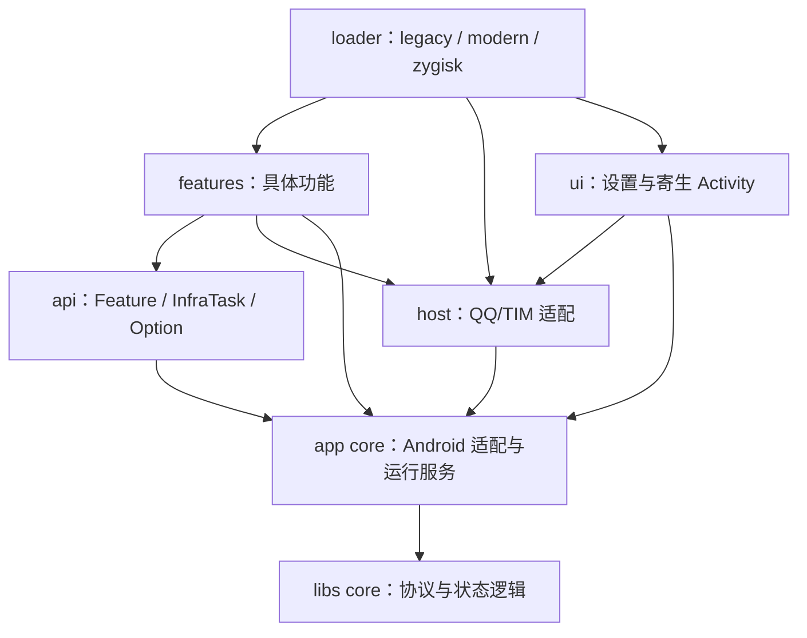

# TCQT 架构

TCQT 将同一套 QQ/TIM 功能运行在 LSPosed 和 Zygisk 两种入口下。两种模式共用宿主数据目录里的配置，但同一宿主只能启用一种 TCQT 注入方式。

## 构建模块

| 模块                | 职责                                                        | 主要依赖边界                                        |
|---------------------|-------------------------------------------------------------|-----------------------------------------------------|
| `:app`              | Android 适配、功能、设置 UI、三种 Hook 入口和原生注入器     | 使用 core；宿主和框架类型留在适配层                 |
| `:libs:core`        | 协议工具、DEX 缓存策略、Hook 契约与生命周期、首帧和启动状态 | 纯 Kotlin/JVM；无 Android、QQ、Xposed、Compose 类型 |
| `:libs:annotations` | 注册注解、进程和优先级元数据                                | Kotlin/JVM                                          |
| `:libs:processor`   | KSP 注册验证和确定性清单生成                                | 构建期使用；不进入 APK                              |
| `:libs:qqinterface` | 编译所需的 QQ 类桩                                          | app 使用 `compileOnly`；运行时由宿主提供            |
| `:webui`            | 校验并暂存离线 HTML/CSS/JS                                  | 无 Node 构建依赖；资源预算 64 KiB                   |
| `buildSrc`          | 类型化的原生模块暂存与双格式 APK 打包任务                   | Gradle 构建逻辑                                     |

`:libs:core` 可以单独执行 `test` 和 `jar`，不执行 app 编译任务。源码沿用 `com.owo233.tcqt.core.*` 包名，避免因模块迁移更改调用方。需要 Android 存储、ClassLoader 或主线程的适配器仍在 app 的 `core/` 中。

## app 分层

功能通过 `api.Feature` 声明开关、配置项和 `install()`；无用户开关的基础任务使用 `api.InfraTask`。`ActionSpec` 是框架内部消费的模型。普通功能不直接实现它，也不直接调用某一 Hook 框架。

app `core` 通过 `HostServices`、`HostBridge` 接收宿主能力。`host/QQHostServices` 提供主题、QUA、Toast、插件加载器等实现。`loader/ModuleLoader` 组装这些能力。架构守卫检查 Java/Kotlin 类型引用和层间依赖，core 不允许静态绑定 QQ、Xposed、Compose 或 Miuix 类型。

## 注册与启动

1. `@RegisterAction` 指定进程、优先级和是否进入注册表。功能分类由 `features/<分类>/` 包名决定。
2. KSP 检查接口、可见性和可构造性；支持 Kotlin `object` 与 JVM 无参类，拒绝 abstract、inner、泛型及 companion object。跨轮收集注册项，按全限定名排序，只生成一次 `GeneratedActionList`。
3. 生成表保存类引用和轻量 `ActionDescriptor`。`ActionRegistry` 先按进程、优先级和 DexKit 缺失项筛选，再实例化选中的功能；设置目录首次访问时再收集完整元数据。
4. `ModuleLoader` 在宿主 `Application.onCreate` 的 Before 中初始化环境，只同步安装 `CRITICAL`。`StartupAfterCreate` 保存计划，在同一 Application 的原调用成功返回后提交，失败则丢弃。
5. `EARLY` 随后转后台执行。主进程的 `DEFERRED` 等待真实首帧，`BACKGROUND` 接在后面分批执行；没有 UI 的进程直接执行。DexKit 在缓存缺失或真实代码身份变化时扫描。

首帧适配器只观察真实 Android Activity，不提前初始化 QQ 的静态 Activity 帮助类。API 29+ 硬件窗口等待 `FRAME_COMMIT`；旧系统或软件窗口等待当前绘制遍历完成；无可用窗口以 4 秒超时兜底。纯 JVM `FirstFrameGate` 保证只完成一次。

## Hook 引擎

`IHookEngine`、`MethodHookParam`、`Unhook` 与调用/生命周期状态位于 `:libs:core`。app 里的 `HookEngineManager` 选择运行时实现：

| 实现               | 入口                        | 原调用                                |
|--------------------|-----------------------------|---------------------------------------|
| `LegacyHookEngine` | 传统 Xposed API             | 框架原调用                            |
| `ModernHookEngine` | libxposed API               | interceptor 原调用                    |
| `ZygiskHookEngine` | 原生注入后的 Java bootstrap | DexMaker bridge/backup + JNI ART 调用 |

三种实现遵守同一套参数、返回值、异常、提前返回和回调失败语义。卸载、并发注册、重入与调用中的卸载由生命周期状态协调。Zygisk 卸载释放 Java 回调，但原方法备份和旧跳板仍须保留；生成 DEX 的回收需要额外证明原生栈已经静默。

## 配置与设置 UI

`SettingsStore` 独占打开既有 FastKV 文件，通过进程内同步、文件锁和持久化 generation 管理快照。稳定锁文件中的 8 字节 generation 只读映射一次；未变化的读取只访问映射与内存快照，不打开文件或获取文件锁。首次读取、generation 变化和写入才进入文件锁。写入先读取最新值，在提交数据前发布失效 generation，提交后原子发布本地快照；其他进程发现变化后持锁重新加载，避免读到未完成的提交。锁文件不得删除或替换，清空配置与导入备份只更新 FastKV 数据。原有文件格式和已发布配置 key 保持兼容。

配置路径由 `HookEnv.moduleDataPath/global/setting` 派生，位于宿主 QQ/TIM 的数据目录；卸载 TCQT APP 不删除它。不要通过清空宿主数据来切换注入模式。

`ConfigRestorePlan` 先完整解码、验证版本与类型，再一次提交兼容设置；损坏备份不会部分写入，宿主本地元数据保留。`SettingViewModel` 负责页面协调，编辑草稿、搜索和 PNG 导入分别由 `SettingsEditSession`、`SettingsSearchState`、`PngImportCoordinator` 管理。

## DexKit 与协议

宿主代码身份来自实际加载的 APK/热补丁 DEX；`DexKitHostCode`、缓存状态和查找跟踪在 core，Android 加载与扫描适配在 app。身份无法可靠读取时采取保守重扫，不能仅用版本名或文件大小判定缓存有效。详见 [DEXKIT.md](DEXKIT.md)。

core 的 `proto` 提供动态协议字段工具。宿主消息适配和防撤回业务保留在 app。处理未知字段和可能含非 UTF-8 字节的消息时，应保持线格式；不能把通用 decode/re-encode 当作无损编辑。

## Zygisk 原生路径

`zygisk_entry` 在 specialization 前通过 root companion 检查实时范围与模块停用状态，接收只读 APK fd 和 SHA-256。权限或配置读取错误中止注入。specialization 后按内容指纹更新宿主缓存，通过 `bootstrap` 和 `InMemoryDexClassLoader` 启动 Java 入口。协议和 SELinux 约束见 [companion 文档](docs/zygisk-companion.md)。

Zygisk 仅接受 Android 13–17（API 33–37），在安装器、specialization 前和 ART/Java 初始化时检查；APK/LSPosed 的 minSdk 独立保留。ART 引擎拆为布局探测、符号解析、内存保护、方法修改和 JNI 原调用；`art_hook.cpp` 只串行初始化并一次发布结果。生成桥和普通托管备份使用经过校验的解释器入口；在覆盖备份前保存不透明 JNI ID，并向 JNI 传入原方法的声明类。未使用的 DEX 信任接口及 Runtime 调试状态猜测已移除。源码依据及验证边界见 [ART 兼容记录](docs/zygisk-art-compatibility.md)。PLT/GOT 引擎按声明表安装替换函数，使用后台库发现，避免在 `dlopen` 回调中重入扫描。

## 产物与验证边界

`SingleArtifact.APK` 由共用 `TransformDualApkTask` 转为双格式包：APK 条目和刷机模块条目并列，不嵌套 payload APK。任务保留原 AGP APK，使用配置的 SDK/NDK 工具 strip、zipalign、V2 签名；Zygisk ZIP 是 Release 双格式 APK 的字节相同副本。

检查分成 JVM 状态/协议测试、app 架构与行为测试、真实 KSP 编译、原生 IPC/内存测试和互斥的 XP/Zygisk 设备测试。命令见 [DEVELOPMENT.md](DEVELOPMENT.md)，本轮逐项证据见 [TODO.md](TODO.md)。当前设备验证覆盖 Android 17 arm64、QQ 9.3.70 和 TIM 4.1.0；不代表所有 Android/OEM/宿主版本都已验证。
