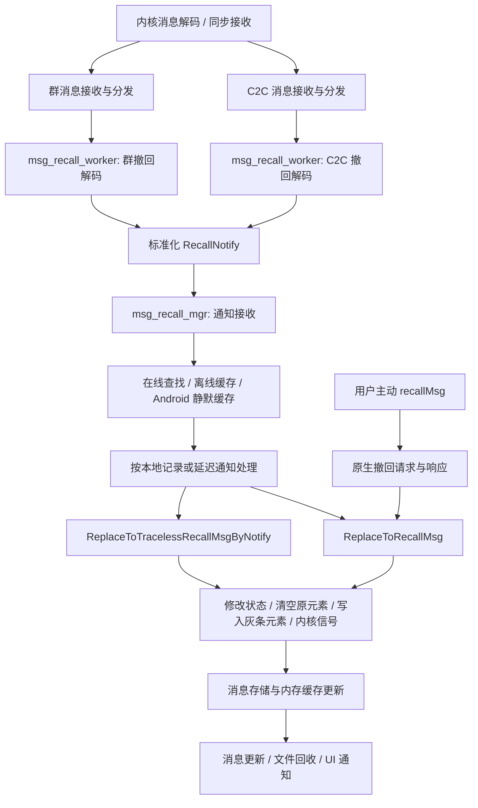

# QQ 9.2.30～9.3.85 内核防撤回分析

现有“消息防撤回”提供 Java / Native 拦截方式，共用原有灰字／顶部提醒选项。
9.3.85 是 Ghidra MCP 完整分析基准；`D:\QQAPK` 范围内的 30 个 APK、28 个
不同内核均已逐个核对 ARM64 指令和布局。完整输入 SHA-256、Build ID、指令点、
UID 查询地址和布局证据见 [native-recall-versions.json](native-recall-versions.json)，
运行适配表位于 `app/src/main/cpp/recall/kernel_profiles.h`。

## 输入、工具和复现

- APK：`D:\QQAPK\9.3.85.43200_59f33114080dbd69.apk`
- APK SHA-256：`4acea88a22288d8554af29cd7c56beee8b438f69419e621210ae7930e7bd864a`
- `lib/arm64-v8a/libkernel.so`：54,862,776 字节
- so SHA-256：`2b1162ab1f7f0a591e7d8d8d441d33183f2954c85148b3ad383042b40d9987a9`
- ELF Build ID：`744ad9d18fb2233fb3a36b44b79c6fbed69b39ed`
- DexSQL MCP：查询 `methods`、`fields`、`class_static_values`，解码 Djinni CppProxy。
- Ghidra MCP：完整自动分析后查询字符串交叉引用、调用者和反编译；NDK
  `llvm-objdump` 对寄存器、间接返回、分支与真实 ELF VA 做交叉确认。

分析原件位于忽略目录 `app/build/analysis/native-recall-9.3.85/`。
Ghidra image base 是 `0x100000`，下文地址均为 **ELF VA/RVA**，运行地址为
`dlpi_addr + RVA`。Ghidra 显示地址需再加 `0x100000`。
函数名来自内核的源码位置日志，并非未剥离的导出符号。

本库大量使用 compiler-outlined helpers。Ghidra 将保存寄存器、设置参数和比较
指令推断成普通函数，反编译中有 `unaff_x*`、`in_ZR` 和错误返回类型。Hook ABI
以真实 ARM64 指令为依据，不能直接复制这些反编译原型。

## 接收和撤回处理链

模块不 Hook Java 或 JNI 的 push 方法。内核先按原有路径完成协议解码；TCQT
在标准化撤回管理和最终记录修改阶段执行 native 指令拦截。

### 好友与临时会话

`OnRecvC2CMsg` 位于 `0x20f9040`，包含解码后列表为空的退出分支和异步消息分发。
`OnRecvMsg` 分发器 `0x20a90bc` 将已识别的 chat type 送入接收处理器。

C2C 撤回 worker `0x226ca20`：

1. 从已解码的内核 PB 对象获取撤回列表。
2. 用当前账号判定 from/to 中哪个是 peer；from UID 同时成为操作者 UID。
3. 提取 seq、client seq、random、time、msg uid 和无痕标记。
4. 形成标准化 `RecallNotify`，分发到撤回管理器；离线、静默和仅 client-seq 的
   无痕撤回有各自的延迟路径。

`IsC2CChatType` 的 native 判定在 `0x1fb8408`。指令实现使用
`(type - 42)` 与位掩码 `0x1c00000000000001`，再单独接纳 type 1，得到
`1 / 42 / 100 / 101 / 102`。
DexSQL 对目标 APK 的静态常量查询确认：

| chat type | APK 常量                    |
|-----------|-----------------------------|
| 1         | `KCHATTYPEC2C`              |
| 2         | `KCHATTYPEGROUP`            |
| 42        | `KCHATTYPEADELIE`           |
| 100       | `KCHATTYPETEMPC2CFROMGROUP` |
| 101       | `KCHATTYPETEMPFRIENDVERIFY` |
| 102       | `KCHATTYPETEMPBUSSINESSCRM` |

APK 还声明 99、103、111、117、119、121、122 等类型；这些不在上述 native
判定集合中，当前实现没有把它们一律视为受支持的临时会话。

在线 worker 的标准化通知会写入 type 1，因此 Java 提醒在好友查找明确返回
MISSING 后，继续查找 100、101、102、42 的实际消息记录，并按实际 chat type
登记提醒。已找到好友消息时不会查找其他会话。native 最终替换拦截器直接读取
记录的 chat type，不把临时会话当成好友记录。

### 群消息

群撤回 worker `0x226e7b8`：

1. 获取 `msg_common::Msg::Body` 中 bytes content。
2. 跳过 **7 字节头**后创建／解码群通知 PB。
3. 读取 `NotifyMsgBody::opt_msg_recall`、group code、操作者和 msg infos。
4. 每条被撤回消息分别生成通知；sender 和 operator 独立保存，所以管理员
   撤回他人消息不能通过 sender 判定为本人操作。

普通通知分发函数 `0x225b724` 和 Android 静默通知分发函数 `0x225ba70` 都
调用这两个 worker。`FillRecallInfoToMsgNotifyInAndrSilence` 在 `0x226d210`
额外填充静默 UI 通知的撤回信息。

### 本人触发撤回

DexSQL 的 `IKernelMsgService$CppProxy.recallMsg` smali 只读取 `nativeRef` 并调用
`native_recallMsg`，它是用户主动操作的入口，当前实现不 Hook 它。
内核 `DoRecallC2CMsg` / `DoRecallGroupMsg` 的请求整理在 `0x2257634`，
响应处理 `OnRecallMsgs` 位于 `0x2258ed0`。响应成功后调用
`ReplaceToRecallMsg(..., by_notify=0)`。

当前 native 判定：

- `by_notify=0` 的主动操作按原逻辑执行。
- 接收通知的 operator UID 等于通过内核会话服务查询的当前账号 UID 时按原逻辑执行。
- 群管理员为当前账号时也放行，即使被撤回消息的 sender 不是当前账号。

账号、操作者比较和放行结果完全在 C++ 内完成。

## 内部修改、缓存和通知

| 函数（RVA） | 静态证据与作用                                                                       |
|-------------|--------------------------------------------------------------------------------------|
| `0x225bd58` | 标准化通知接收；先检查 seq，再进入在线查询、离线缓存、静默缓存                       |
| `0x225c688` | `UpdateMsgToRecallGrayTipByNotify`；遍历本地记录，区分已删除／不可替换记录和无痕撤回 |
| `0x225df18` | `OnRecallMsgNotifyWithLocalRecord`；普通与无痕两路分发                               |
| `0x2259a90` | `ReplaceToRecallMsg`；原消息状态与元素替换、附加撤回元数据和信号                     |
| `0x225a3fc` | 设置原生记录状态参数 5 / 4，更新状态时间等字段                                       |
| `0x225a460` | 创建撤回元素 PB；元素 type 8、operator UID、操作类型、附加文字等字段                 |
| `0x225a8d0` | `ReplaceToTracelessRecallMsgByNotify`；校验 random、执行无痕变更及后续存储事件       |
| `0x225acdc` | 无痕变更：状态参数 1 / 1，并清空元素列表                                             |
| `0x2265710` | `DoDelayHandleRecallMsgNotify`；延迟处理后进入记录替换                               |
| `0x226672c` | Android 静默缓存更新；调用普通／无痕替换，也有构造新记录的分支                       |
| `0x2268bc0` | 另一异步本地记录回调；调用普通／无痕替换                                             |
| `0x225a788` | 消息信号发射，检查执行线程，后续接入内存／存储／UI 订阅者                            |
| `0x225dc60` | `OnRecvRecallNullSvrMsg`；服务器空消息／撤回占位补偿，直接构造撤回元素               |
| `0x225d73c` | `InterAddMsgWithRecallNotify`；原消息到达时与缓存的撤回通知合并                      |
| `0x225e5fc` | 构造新记录并设置撤回状态的静默补偿路径                                               |

前三类截断目标：通知进入缓存之前、已有记录被修改之前、无痕变更之前。
TCQT 没有 Hook 通用数据库 delete、通用消息接收、文件删除或 Java UI 回调来
阻止正常清理。`RemoveRecallOrDeleteMsgs`、`OnMsgRecall` 等下游名字不能直接
作为全部删除操作的屏蔽依据。

## 指令 Hook 与数据布局

| 指令 RVA    | 原指令              | 寄存器与原分支                                                              |
|-------------|---------------------|-----------------------------------------------------------------------------|
| `0x225bd8c` | `CBZ X8, 0x225c2b0` | X0=manager、X1=notify、X8=notify.seq；在首次查询／缓存之前退出              |
| `0x2259aac` | `CBZ X8, 0x225a3c0` | X0=manager、X8=record、X2=operator string、W5=by_notify；在元素修改之前退出 |
| `0x225a8e8` | `CBZ X8, 0x225acbc` | X0=manager、X2=notify、X8=record；在无痕修改之前退出                        |

`DobbyInstrument` 在这些函数内部的指令处保存寄存器、执行拦截器，再执行
重定位的原指令。命中其他人的撤回时只把 X8 设为零，使用原 `CBZ` 跳到原
函数的清理／返回路径。不会置空消息对象、销毁 shared_ptr 或改写 notify。
这些点依赖 X8，不依赖进入拦截器前的 NZCV；X17 在这些点没有存活的业务值。
启用 Dobby 的完整浮点寄存器保存。

通知布局来自两个 worker 的实际 store 指令与调用者读取：

| 偏移                 | 字段                                  |
|----------------------|---------------------------------------|
| `0x00`               | peer UID（libc++ string）             |
| `0x18`               | chat type（byte）                     |
| `0x20 / 0x28`        | seq / client seq（uint64）            |
| `0x30 / 0x38 / 0x40` | random / msg uid / time               |
| `0x48 / 0x60`        | sender UID / recipient UID（string）  |
| `0x78 / 0x80`        | 操作类型 / operator UID               |
| `0xa8`               | 附加文字（string）                    |
| `0xc0 / 0xc1 / 0xc2` | offline / traceless / Android silence |

`manager + 8` 是内核会话标识 string，不能直接与 QQ 账号 UID 比较。
C2C worker 在 `0x226cbf8` 调用会话参数查询 `0x17a9df4`，参数为
`(session.data, session.length, 0x10, 1, &5003, &uid)`。本实现使用同一原生调用
获取 UID，拦截判定不调用 Java。较老内核把参数保存指令进一步 outline；适配表
记录每个版本的真实查询函数，并检查 X2～X5 的参数传递。

`0x1572bf0` 的 load／select 指令确认本库使用
24 字节 libc++ 默认 string：短字符串第一个字节低位为零、长度右移一位；
长字符串长度在 +8，指针在 +16。模块读取 view 后复制，不修改 QQ 所有的 string。

记录 vtable 的 `+0 / +8 / +0x18 / +0x40 / +0xa0` 分别用于读取 msg id、
chat type、seq、sender UID、peer UID。string 返回遵守 AAPCS64 的 X8 间接
返回约定；不能把它们当成 `char*` 函数调用。

通知的 `+0x38` 是服务端消息 UID；记录 getter 的 msgId 是本地消息 ID。
两者不能混用：标准化通知快照用 seq、sender、time、random 定位；已有记录
替换路径才传入实际本地 msgId。Java 提醒桥检查的是查询所得的 UID。

模块仅在 ELF Build ID、三处指令字和 UID 查询函数的首指令全部匹配时安装，
并在全部成功后激活。
未知版本不按固定偏移修改。QQ 热补丁若更换 so，同样要重新分析 Build ID。

## Dobby 与 ShadowHook，双注入模式

| 能力／验证               | Dobby（所选固定提交）         | ShadowHook 2.0.1                  |
|--------------------------|-------------------------------|-----------------------------------|
| 内部无符号地址           | 支持                          | 支持                              |
| 指令拦截及通用寄存器修改 | `DobbyInstrument`             | `shadowhook_intercept_instr_addr` |
| Android linker 集成      | 本实现关闭，不依赖            | 初始化包含 linker 模块            |
| 当前 Android 17 设备探针 | 45 项通过                     | 初始化错误 12：linker 模块失败    |
| 选择                     | 静态链接到 `libtcqtrecall.so` | 未进入最终依赖／APK               |

此选择依据当前设备证据，不把 ShadowHook 的失败泛化到所有系统。
Dobby 提交 `0932d69c320e786672361ab53825ba8f4245e9d3`，源码包 SHA-256
`1f5b1e612d54f21d40aefb5d0c15fc21d6699b5b402fb657886ec9a0f5d5b829`。

LSPosed 官方 Native-Hook 提供函数替换能力和库加载通知，但没有上述指令上下文
拦截接口。本实现按官方文档导出 `native_init`，登记 `assets/native_init`，只用
库加载通知；没有使用其 `hook_func`。
两种模式都加载同一个 `libtcqtrecall.so`，由同一个 C++ 实现安装 Dobby 指令点。
native `dl_iterate_phdr` 扫描覆盖已加载的库；50 ms 扫描线程补充晚加载，找到目标
后退出。没有增加 `dlopen`／`android_dlopen_ext` GOT 触发器。

使用现有功能开关 `msg_anti_recall` 和原有提醒位掩码 `msg_anti_recall.type`。
新增单选项 `msg_anti_recall.mode`：0=Java，1=Native；Native 模式不安装 Java
push／后台防撤回 Hook。曾安装独立 Native 功能的配置在首次读取设置时原子迁移，
保留启用状态、两项提醒和原解析选项；已保存统一模式选择时不覆盖。
两种注入模式的配置入口和 native 引擎相同。
Java 启动调用只承担配置激活和 JNI 绑定，native 判定不调用 Java。
拦截器把内核解码后的元数据复制到队列，独立线程发送快照；Java 用 protobuf
读取快照，再复用 `Recall`、`RecallManager`、目标查找、灰条和顶部提醒。
JNI 提醒异常不会撤销 native 拦截结果。

## 验证范围与待验收路径

设备：REDMI K90 Pro Max，Android 17/API 37。
`tools/test-native-recall.ps1` 编译实际 AArch64 CBZ 探针，使用**生产拦截器**执行
好友、群管理员、群临时会话、本人通知、主动撤回、无痕撤回、元数据复制、
字符串返回 ABI、client-seq-only 无痕通知的本地 seq、会话 ID 到 UID 的查询、
服务器 UID 与本地 ID 的区分、未启用与卸载恢复等 17 项检查；另有 27 个已适配
Build ID 的选择和未知 Build ID 拒绝检查，共 45 项，全部通过。
它不更改 QQ 或 TCQT 设置。

探针不是 QQ 会话验收。当前 LSPosed 真机已收到好友、群撤回的 Native 事件，
截图确认两者的“已拦截”灰字出现在聊天列表。随后实际好友 AIO 截图显示
保留正文、底部灰字和红色顶部标记，但日志显示 16:34:43 已切回 Java，
截图中 seq 260～262 不能作为 Native 顶部提醒的验收证据。Native 顶部提醒、
临时会话和 Zygisk 模式仍需宿主回归：

- 好友、群、群临时会话的单条／连续撤回和管理员撤回。
- 当前账号主动撤回以及另一个登录设备发起的本人撤回。
- native 拦截后的灰条与顶部提醒，含仅开启顶部提醒的临时会话。
- 进程重启后的 InfoSync 空消息补偿、已存在离线／静默缓存、仅 client-seq 的
  无痕撤回、流式消息的独立补偿处理。

特别是 `OnRecvRecallNullSvrMsg` 与构造新记录的补偿分支，并不全部调用所选
最终替换函数。首次标准化通知被截断会阻止本次新增缓存；这不能证明所有
历史缓存或服务器占位重放都已覆盖。当前实现不宣称上述路径全部通过。
Zygisk 晚加载扫描也存在最多一个扫描周期的安装延迟，需要实际启动日志确认
安装先于第一条撤回处理。

测试中设置开关／注入模式由用户手动改变；APK 安装、进程重启和日志采集由
工具执行，遵守仓库 AGENTS.md。

2026-11-18 合并功能与提醒修复后的构建和部署检查：

- Debug、R8 Release、`lintDebug` 成功；lint 0 errors / 39 warnings。
- app JVM 测试 278 项，0 failures / 0 errors / 3 skipped，包含三项配置迁移检查。
- 两种构建的双格式内容校验、APK 签名与 `zipalign -c -P 16 4` 成功。
- Release 的 Linux `unzip -t` 成功；Zygisk ZIP 与双格式 Release APK 字节一致。
- Release 大小 4,122,863 字节，使用本地 Android Debug 证书。
- 最终 Release SHA-256：`c41b88857e6978122b7a3d747f132238c22a7957d6df6b127bfc07eb7ad5fb69`。
- 已 ADB 安装并重启 QQ，设备上安装的 base.apk SHA-256 与上述值一致。
- DexSQL 验证 R8 输出保留 `NativeRecallBridge.nativeStart()Z` 与
  `onNativeRecall([B)V`；ELF 导出 `native_init` 和 JNI 启动符号。
- APK 内只有 `libtcqtrecall.so` 包含本引擎，没有 ShadowHook／额外 Dobby 动态库。
- 16:32 重启后的日志没有原 Java push 防撤回入口；已记录 `chatType=2 seq=3024` 和
  `chatType=1 seq=256` 的 Native 事件。截图中好友和群会话均出现对应灰字。
  16:34:43 起再次出现 Java push 回调；此后好友截图中的连续顶部标记来自
  Java 模式，不能当作 Native 顶部提醒的验证。
  截图与日志保存在 `app/build/analysis/native-recall-versions/` 的本地验证目录。

## 逐版本静态验证复现

`tools/analyze-native-recall.py D:/QQAPK app/build/analysis/native-recall-versions`
需要 Python 的 pyelftools、capstone、numpy。脚本从 APK 提取原件，以日志字符串
交叉引用和 `.eh_frame_hdr` 的函数边界定位好友 worker、群 worker、通知接收及
两种替换处理，再检查 CBZ X8 的原退出目标、参数寄存器、会话 UID 查询、24 字节
libc++ string、通知标量字段和记录 getter。输出指令列表、`evidence.json`、
`inventory.json` 和适配表；同 Build ID 的 APK 必须有相同 so SHA-256。

9.2.65 / 9.2.66、9.3.0 / 9.3.1 分别共用内核，其余输入各有自己的 Build ID。
没有输入 APK 的中间发行版不宣称适配；更换内核的热补丁也不按版本号猜地址。

### 补充 QQ 9.3.70.41925

输入为 `D:\QQAPK\9.3.70.41925_2a98ecf56e5ef04b.apk`，APK SHA-256 为
`e8c28713b740c18246989d47916d9fbbad06d440778a5aab3f4e108a2423e55c`。
提取的 ARM64 `libkernel.so` 为 53,709,184 字节，SHA-256 为
`9adfd1c2785b1bc037b8de92421cc09b0b40eef80cea5c95e989aa37e60c5a32`，
Build ID 为 `a203ba89f2d9a4124e0ee18d392523c82511514e`。
它与 9.3.65、9.3.75 的内核都不同，必须单独登记，不能复用相邻版本的地址。

| 版本         | 通知 Hook RVA | 普通替换 Hook RVA | 无痕替换 Hook RVA | UID 查询 RVA |
|--------------|---------------|-------------------|-------------------|--------------|
| 9.3.65       | `0x2178c40`   | `0x2176978`       | `0x21777d8`       | `0x1711568`  |
| 9.3.70.41925 | `0x21a002c`   | `0x219dd64`       | `0x219ebc4`       | `0x172d1a8`  |
| 9.3.75.42350 | `0x21d5de8`   | `0x21d3b08`       | `0x21d4944`       | `0x174fdf0`  |

9.3.70 三个 CBZ X8 指令字为 `0xb4002928 / 0xb4004988 / 0xb4001d48`，
与 9.3.65 相同，对应原退出目标为 `0x21a0550 / 0x219e694 / 0x219ef6c`。
9.3.75 的普通／无痕分支已变为 `0xb40048a8 / 0xb4001ea8`，函数内部指令
也有变化，不能用它的指令字校验 9.3.70。

逐函数比较了通知接收、普通替换、无痕替换、C2C worker 和本地记录分发的
ARM64 指令；9.3.70 更接近 9.3.65。另行验证三处前置 load、普通替换的
`MOV W21,W5`、无痕替换的 `LDRB W9,[X2,#0xc1]`、通知标量偏移、记录 getter
槽位和 24 字节 libc++ string 布局。UID 查询首指令仍为 `0xd10243ff`，其
outlined helper `0x17331cc` 保存 X3～X5，查询函数保存 X2，原生参数约定兼容。
因此本次只增加专属 profile 和证据，不需要修改拦截回调或 Java 提醒代码。

9.3.70 的原件、逐函数指令列表和证据位于
`app/build/analysis/native-recall-versions/9.3.70.41925_2a98ecf56e5ef04b/`，
相邻版本指令比较位于同级 `9.3.70-adjacent-instruction-comparison.txt`。
本版本目前完成静态验证；尚未在运行 QQ 9.3.70 的设备上验收撤回与提醒。

补入后 ARM64 探针 72 项全部通过，包含 28 个内核 Build ID 的选择检查。
Debug、Release、Zygisk ZIP 构建及双格式内容、签名、16 KiB 对齐、Linux ZIP CRC
检查通过；两种 APK 内均确认包含 9.3.70 的版本与 Build ID。
Release 为 `4.0.2.r742.56ca99f`，4,122,799 字节，使用本地 Debug 证书，
SHA-256 为 `bc52e73375547a2cda3fcd0221583ba0f5ed954c6c45b7ebed49924c09ad7dd8`。

## Native 健壮性修正

用户随后确认 Native 防撤回及两种提醒可用。本次修正聚焦资源与错误路径：

- 提醒队列最多 1024 条，满时丢弃最老快照并记录警告；JNI 投递失败丢弃该事件，
  日志明确区分提醒丢弃与消息撤回拦截。失败事件不反复入队。
- 安装状态使用 Waiting / Failed / Installed。旧实现的 `seen_kernel` 已能阻止
  重试；显式状态进一步让初始化返回值反映失败，轮询和加载回调都不再次安装。
- JNI 方法解析在 global ref 创建之前完成。消费者使用可返回错误码的
  `pthread_create`，并等待 JNI attach 成功后才允许安装 Hook；失败时清理绑定。
  终止投递时清空队列、释放 global ref 并 detach daemon。
- 空对象在三个 Hook 回调边界检查；string view 处理零地址和空的长字符串存储。
  UID 查询失败时舍弃可能不完整的输出，不用它进行本人撤回判定。
- 字符串 getter 单独使用 `std::string (*)(void*)`，由 ARM64 libc++/Clang 的
  AAPCS64 非平凡返回约定传递 X8。`void (*)(void*, std::string*)` 会使用 X1，
  与内核 ABI 不匹配。测试 fixture 以独立汇编显式读取 X8 并构造长／短结果。
- 共用 `kSites` 和统一虚表字节偏移。安装时除 CBZ 外还核对前置 load、
  `MOV W21,W5` 和 `LDRB W9,[X2,#0xc1]`，29 个输入 APK 均通过新增检查。
  W5 是含 this 的第六个机器参数、第五个显式 C++ 参数。
- 无痕回调保留原 `traceless` 资格判断，未设置该标记的调用不产生拦截或提醒。
- 安装后检查指令确实被修改，回滚时检查状态码和首指令恢复。即使回滚失败，
  回调保持未激活，且不重试。不把 Dobby 的返回 0 单独作为写入成功证据。
- 损坏 note 无法计算下一条的可靠位置时跳过该 PT_NOTE 段，继续检查后续段。

ARM64 探针共 71 项通过，包含部分安装失败、回滚失败、返回成功但未写入、
线程创建／JNI attach 失败、队列溢出、JNI 投递异常、独立 X8 返回和坏 note。
故障注入只发生在独立探针，不改变 QQ 设置或故意使宿主出错。

本次 Debug、Release、Zygisk ZIP 构建通过，双格式内容、APK 签名、16 KB 对齐
和 Linux ZIP CRC 检查通过。Release 为 `4.0.2.r742.56ca99f`，4,122,799 字节，
本地 Debug 证书，SHA-256 为
`ce859bd1dba710ef06b044377154387d39fc7b6f80fe8b2a05378c636ac2a1a0`。
已安装并重启 QQ，设备 base.apk 哈希一致。该次启动配置为 Java，日志正常；
新增错误路径和 ABI 验证由独立 ARM64 探针覆盖，不宣称该次 Native 宿主回归已完成。
